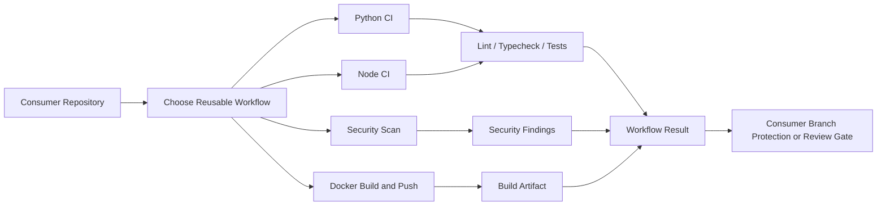
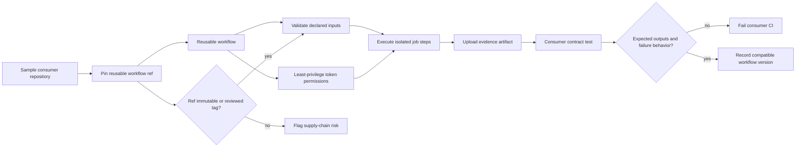

# Workflow Lab 🔧

> **Reusable GitHub Actions, composite workflows, and automation templates for the Arise GenOps ecosystem.**

[](LICENSE)

## 📦 Workflows

| Workflow | Description | Usage |
|----------|-------------|-------|
| `python-ci` | Lint, type-check, test Python packages | `uses: abhiachar126-s/workflow-lab/.github/workflows/python-ci.yml@main` |
| `node-ci` | Lint, build, test Node.js packages | `uses: abhiachar126-s/workflow-lab/.github/workflows/node-ci.yml@main` |
| `security-scan` | CodeQL + TruffleHog + Trivy | `uses: abhiachar126-s/workflow-lab/.github/workflows/security-scan.yml@main` |
| `docker-build` | Multi-arch Docker build & push | `uses: abhiachar126-s/workflow-lab/.github/workflows/docker-build.yml@main` |

<!-- X4-APEX-DIAGRAM-START:workflow-lab -->



<!-- X4-APEX-DIAGRAM-END:workflow-lab -->

## 🚀 Quick Start

```yaml
# .github/workflows/ci.yml
name: CI
on: [push, pull_request]
jobs:
  python:
    uses: abhiachar126-s/workflow-lab/.github/workflows/python-ci.yml@main
    with:
      python-version: '3.11'
      working-directory: './packages/my-package'
```

## 🏗️ Structure

```
.github/
  workflows/          # Reusable workflows
  actions/            # Composite actions
  scripts/            # Helper scripts
examples/             # Usage examples
docs/                 # Documentation
```

## 📜 License

MIT © 2026 Arise GenOps

## APEX Architecture Map

> Status: architecture documentation; implementation and deployment claims require independent verification.



**Evidence note:** A reusable workflow is validated only when a real consumer exercises both success and failure paths on the pinned reference.

